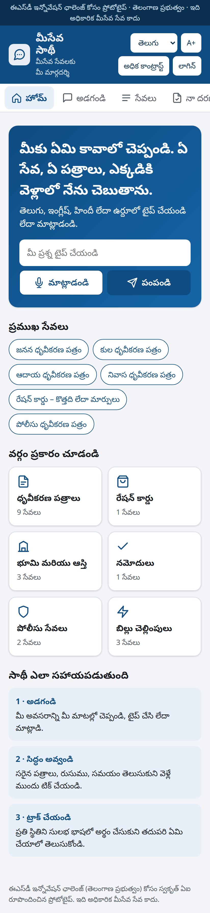
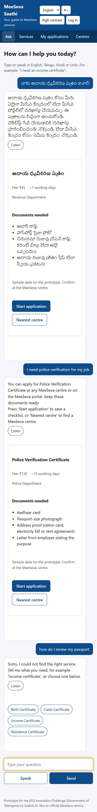
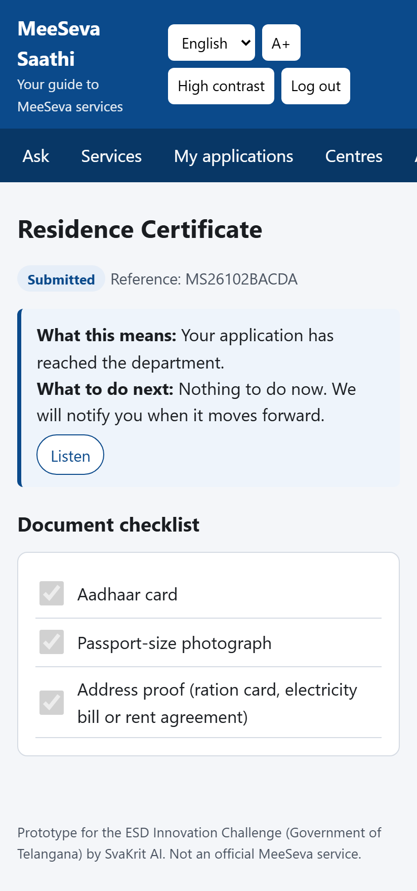
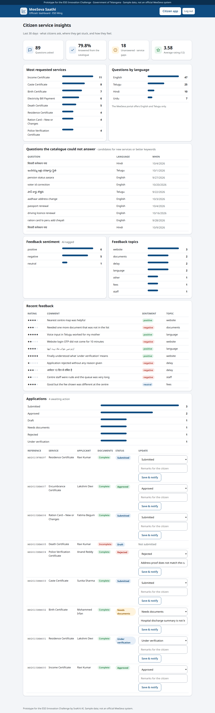

# MeeSeva Saathi

**An AI-assisted, multilingual guide that helps every citizen of Telangana find, prepare for and follow
MeeSeva services, in Telugu, English, Hindi or Urdu, by typing or speaking.**

Submission for the **Electronic Service Delivery (ESD) Innovation Challenge**, Government Digital Services
track (Aikam / TalentFarm, ITE&C Department, Government of Telangana). Team: **SvaKrit AI**.

> Prototype. Service timelines follow the official MeeSeva revenue catalogue; the service list, fees and
> centre list are **sample data** prepared for the demo, not official MeeSeva figures. It is not connected
> to any government system.

| Home (Telugu) | Ask Saathi | Application status | Officials' dashboard |
|---|---|---|---|
|  |  |  |  |

More screens in [`docs/screenshots/`](docs/screenshots/).

---

## The problem, from the research

MeeSeva handles about **32.5 lakh transactions a month across 391 services and 5,265 centres**, yet the
official portal shows **42 lakh applications pending beyond their time limit since January 2025** and
**92 lakh rejections** to date, and it is available in English and Telugu only
([portal statistics](https://ts.meeseva.telangana.gov.in/meeseva/home.htm), read 21 Oct 2026).
Behind those numbers are three questions citizens struggle with before they ever reach a counter:

1. **Which service do I need?** People describe a need ("my father passed away and we need the pension"),
   not a certificate name.
2. **What must I carry?** A police SOP records that unclear or missing documents cause delays and repeat
   visits: another day's wages lost.
3. **What does my status mean, and what do I do now?** "Under verification" says nothing about the next step.

Full notes, sources and how each finding shaped the design: [`docs/RESEARCH.md`](docs/RESEARCH.md)
(also summarised inside the app under **Why Saathi**).

## The solution

| For citizens | For ESD officials |
|---|---|
| **Ask Saathi**: describe the need in your own words and language, by text or voice; get the right service, the documents to carry, fee and time | **Insights**: the most requested services, questions by language, and the questions the catalogue could not answer (service gaps) |
| **Document checklist**: start an application, tick documents as you collect them; submit only when complete | **Feedback, tagged by AI**: sentiment and topic (documents, fees, delay, website, language, staff) |
| **Plain-language status** with a visual timeline: what the status means and what to do next, read aloud on request | **Application processing**: update the status with remarks; the citizen is notified in their language |
| **Nearest MeeSeva centre** by location or district, with a map link | |
| **Accessible by design** (GIGW 3.0 / WCAG 2.1 AA intent): large text, high contrast, screen-reader labels, keyboard operation, right-to-left Urdu, works on a basic phone over 4G | |

**Where it fits:** the state launched MeeSeva on WhatsApp in November 2025. Saathi is the preparation and
explanation layer, built API-first so the same assistant can sit behind WhatsApp, the portal and centre kiosks.

### AI functionality

- **Understanding the citizen**: language detection by script (Telugu, Devanagari, Urdu, Latin), then
  either the **Azure OpenAI** engine (gpt-5-mini, grounded in the catalogue, forced JSON output) or the
  built-in **multilingual rules engine**. The AI maps needs to services ("scholarship" → income certificate;
  "pension after a death" → death certificate).
- **Never down**: if the AI is not configured, slow or failing, the rules engine answers instead. The app
  runs fully offline for reviewers.
- **Grounded**: the AI may answer only from the catalogue, uses the official names in the citizen's
  language, never invents fees or timelines, and says "confirm at the centre".
- **Feedback analysis**: every comment is tagged with sentiment and topic (AI, with a lexicon fallback).
- **Voice**: speech-to-text and text-to-speech in the browser (te-IN, hi-IN, en-IN, ur-IN), no extra cost.

## Technology stack

| Layer | Technology |
|---|---|
| Backend | Python 3.12, FastAPI, Pydantic v2 (validation), Uvicorn |
| Database | SQLAlchemy 2 ORM, 12 tables; SQLite by default, any SQL database via `DATABASE_URL` |
| AI | Azure OpenAI (gpt-5-mini) with a built-in multilingual rules engine as fallback |
| Frontend | HTML, CSS, vanilla JavaScript (no build step), Noto fonts, Web Speech API for voice |
| Auth | Mobile number + 6-digit OTP (hashed, 5-minute expiry, 5 attempts); signed session tokens; citizen and official roles |
| Tests | pytest + FastAPI TestClient (42 automated tests); browser walkthrough with Playwright |

## Run it

Requirements: Python 3.11 or newer.

```bash
git clone https://github.com/chiragmakvana/meeseva-saathi.git
cd meeseva-saathi
python -m venv .venv
# Windows: .venv\Scripts\activate    macOS/Linux: source .venv/bin/activate
pip install -r requirements.txt
cp .env.example .env            # optional: add Azure OpenAI settings to enable the AI engine
python -m app.seed --demo       # create the database, load the catalogue and sample citizen activity
uvicorn app.main:app --reload
```

| Open | What |
|---|---|
| http://127.0.0.1:8000 | Citizen app |
| http://127.0.0.1:8000/official | Officials' dashboard (demo official mobile: **9000000001**) |
| http://127.0.0.1:8000/docs | Interactive API documentation (Swagger) |

**Logging in:** enter any valid 10-digit mobile number (starting 6–9). No SMS is sent in the prototype; the
OTP is shown on screen (`DEMO_OTP_MODE=true`). `python -m app.seed` without `--demo` loads the catalogue only.

### Configuration (`.env`)

| Variable | Purpose | Default |
|---|---|---|
| `DATABASE_URL` | SQLAlchemy URL | `sqlite:///./meeseva_saathi.db` |
| `SECRET_KEY` | Signs sessions and hashes OTPs: **set a long random value** | demo value |
| `DEMO_OTP_MODE` | Show the OTP on screen (no SMS gateway) | `true` |
| `AZURE_OPENAI_ENDPOINT`, `AZURE_OPENAI_API_KEY`, `AZURE_OPENAI_DEPLOYMENT`, `AZURE_OPENAI_API_VERSION` | Enable the AI engine | empty → rules engine |

No keys or passwords are stored in this repository.

### Tests

```bash
pytest                         # 42 tests, runs offline
python -m scripts.test_report  # re-runs the tests and regenerates docs/TESTING.md
```

## Documentation

- [Research](docs/RESEARCH.md): MeeSeva facts, citizen pain points, standards, and the design decisions they led to
- [API reference](docs/API.md): every endpoint with request, response and authentication
- [Database](docs/DATABASE.md): entity-relationship diagram, tables, keys and important queries; DDL in [`db/schema.sql`](db/schema.sql)
- [Testing](docs/TESTING.md): test cases with expected and actual results, bugs found and fixed

## Project structure

```
app/
  main.py            FastAPI app, routes, startup (creates tables, loads the catalogue)
  config.py          settings from environment variables
  database.py        engine and sessions
  models.py          12 tables (SQLAlchemy)
  schemas.py         request/response validation
  security.py        OTP login, session tokens, roles
  assistant.py       AI layer: language detection, rules engine, Azure OpenAI, feedback tagging
  texts.py           server-side sentences in four languages
  seed.py            catalogue (19 services, 24 document types, centres) and --demo citizen activity
  routers/           auth, catalogue, assistant, applications, engagement (feedback, notifications), admin
static/              citizen app (index.html, app.js, i18n.js), officials' dashboard, styles
tests/               pytest suite
db/schema.sql        database DDL (generated)
docs/                research, API, database, testing, screenshots
scripts/             schema export, test report
```

## Roadmap (beyond the MVP)

- Connect to the official MeeSeva service master and live application status (ESD APIs).
- Deploy the assistant behind the MeeSeva WhatsApp channel; SMS OTP through the state gateway.
- Pre-filled application forms from DigiLocker documents, with consent.
- Kiosk mode for MeeSeva centres; Telugu speech recognition tuned for rural accents.
- Department-wise dashboards with service-level tracking; accessibility audit and STQC certification.

## Team

| Member | Contribution |
|---|---|
| **Chirag Makvana** | Research, AI assistant engine (language detection, rules engine, Azure OpenAI integration and fallback, feedback tagging), backend APIs, login and security, database design |
| **Bansi Chirag Makvana** | Citizen experience: multilingual interface, accessibility (GIGW 3.0), document checklist and status-explainer flow, officials' dashboard, test cases and walkthrough testing |

Built with AI-assisted development tools.

---

© 2026 Svakrit AI Private Limited. Shared for evaluation in the ESD Innovation Challenge.
