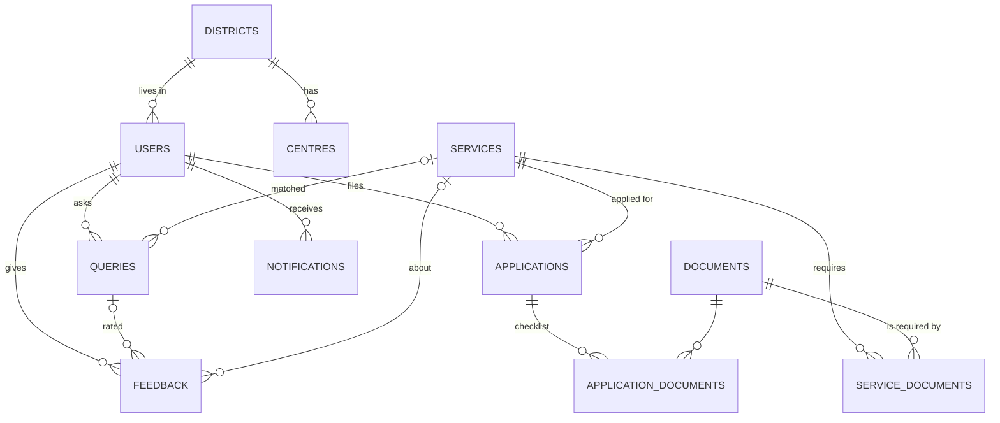

# Database

SQLAlchemy 2 models in [`app/models.py`](../app/models.py); generated DDL in [`db/schema.sql`](../db/schema.sql)
(`python -m scripts.export_schema`). SQLite by default with foreign keys enforced; PostgreSQL works by
changing `DATABASE_URL`. Sample data: `python -m app.seed` (see [`app/seed.py`](../app/seed.py)).

## Entity-relationship diagram



## Tables

| Table | Primary key | Foreign keys | Purpose |
|---|---|---|---|
| `districts` | id | – | Telangana districts (English and Telugu names) |
| `users` | id (unique mobile) | district_id → districts | Citizens and officials (`role`), preferred language |
| `otp_codes` | id | – | Hashed OTPs with expiry and attempt count |
| `services` | id (unique code) | – | Catalogue: names in four languages, department, eligibility, fee, time, multilingual keywords |
| `documents` | id (unique code) | – | Document types, names in four languages |
| `service_documents` | (service_id, document_id) | → services, → documents | Which documents each service needs (many-to-many) |
| `centres` | id | district_id → districts | MeeSeva centres with coordinates and hours |
| `applications` | id (unique reference_no) | user_id → users, service_id → services | Citizen applications and their status |
| `application_documents` | id | application_id → applications (cascade), document_id → documents | The checklist for one application |
| `queries` | id | user_id → users (nullable), matched_service_id → services (nullable) | Every question asked, language, engine used, confidence |
| `feedback` | id | user_id → users, query_id → queries, service_id → services | Ratings and comments with AI-tagged sentiment and topic |
| `notifications` | id | user_id → users | Status updates in the citizen's language |

**Integrity rules in the database:** `CHECK` constraints on `users.role`, `users.preferred_lang`,
`applications.status` and `feedback.rating` (1–5); unique mobile, service code, document code and
application reference; cascade delete of a draft's checklist.

## CRUD in the application

| Operation | Where |
|---|---|
| Create | users (first login), applications + checklist, queries, feedback, notifications |
| Read | catalogue, centres, my applications, notifications, insights |
| Update | profile, draft application, checklist ticks, status (officials), notification read |
| Delete | draft application (checklist removed by cascade) |

## Important queries

Insights for the ESD wing (implemented with SQLAlchemy in [`app/routers/admin.py`](../app/routers/admin.py)):

```sql
-- Most requested services
SELECT s.name_en, COUNT(q.id) AS asked
FROM queries q JOIN services s ON s.id = q.matched_service_id
GROUP BY s.name_en ORDER BY asked DESC LIMIT 8;

-- Service gaps: questions the catalogue could not answer
SELECT text, lang, created_at FROM queries
WHERE matched_service_id IS NULL ORDER BY id DESC LIMIT 10;

-- Questions by language
SELECT lang, COUNT(*) FROM queries GROUP BY lang;

-- Applications by status
SELECT status, COUNT(*) FROM applications GROUP BY status;
```

Is an application ready to submit?

```sql
SELECT a.reference_no, MIN(ad.provided) = 1 AS ready
FROM applications a JOIN application_documents ad ON ad.application_id = a.id
WHERE a.id = :id GROUP BY a.reference_no;
```
