# Demo video script, scene by scene

The narrated demo (`SvaKritAI_Demo.mp4`, 1080p, 3:29 min) is built from the ten scenes below. Each scene is one narration clip (`demo_segments.json`, Azure neural voice en-IN-Neerja) played over the screen recording; spoken time 3.2 min. The same scenes, in the same order, are steps of the live-demo runbook (`LIVE_DEMO_STEPS.md`), so you can also record this script yourself over a live run.

**Rebuild the video** after any change to the app or the words:

```bash
python -m scripts.narrate docs/demo/demo_segments.json docs/demo/audio   # clips + durations.json
python -m app.seed --demo && uvicorn app.main:app --port 8000               # fresh data, in another terminal
node scripts/record_demo.mjs http://127.0.0.1:8000 docs/demo               # paced recording + timestamps.json
python -m scripts.build_demo_video                                          # mixes to SvaKritAI_Demo.mp4
python -m scripts.demo_script                                               # regenerates this file
```

**Record it in your own voice instead:** run the app as in the runbook, screen-record a phone-sized window (about 420 px wide, zoom 125–150 %) plus a desktop window for the dashboard, and read each scene’s words while doing its runbook steps. Keep the mouse still while speaking; avoid reading screen text aloud; after a slip, pause two seconds and repeat the sentence (easy to cut).

| # | Scene | Starts | Clip | Runbook steps |
|---|---|---|---|---|
| 1 | Home in Telugu | 0:02 | 22 s | 1 |
| 2 | Income certificate, in Telugu | 0:26 | 23 s | 2–3 |
| 3 | Pension after a death, in English | 0:50 | 35 s | 4 |
| 4 | Not a MeeSeva service | 1:26 | 16 s | 5 |
| 5 | Login with OTP | 1:43 | 14 s | 6–7 |
| 6 | Checklist, submit, timeline | 1:59 | 27 s | 8–11 |
| 7 | Urdu, right-to-left | 2:27 | 13 s | 13 |
| 8 | Officials’ dashboard | 2:40 | 22 s | 14–17 |
| 9 | Citizen notification | 3:03 | 8 s | 18 |
| 10 | Why Saathi | 3:12 | 14 s | 19 |

## Scene 1 of 10 · Home in Telugu

**Clip:** about 22 s · starts at 0:02 in the video · runbook step 1

**On screen:** Phone frame. Telugu home: question box, popular services, category tiles; slow scroll down and back. Prototype strip at the top.

> This is MeeSeva Saathi. Saathi means companion. A citizen opens it on any phone and sees one question box, the popular services and the categories, in Telugu by default. The strip at the top says clearly that this is a prototype built for the ESD Innovation Challenge.

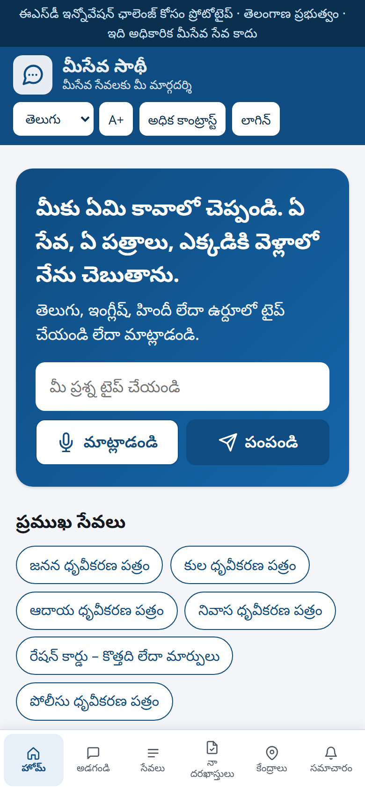

## Scene 2 of 10 · Income certificate, in Telugu

**Clip:** about 23 s · starts at 0:26 in the video · runbook steps 2–3

**On screen:** Typing నాకు ఆదాయ ధృవీకరణ పత్రం కావాలి; the Telugu answer and the Income Certificate card (fee, time, four documents, Listen).

> I type, or speak, that I need an income certificate, in Telugu. Saathi answers in Telugu: which service it is, the four documents to carry, the fee, and the official seven-day timeline. A card summarises it, and the Listen button reads the answer aloud for someone who cannot read easily.

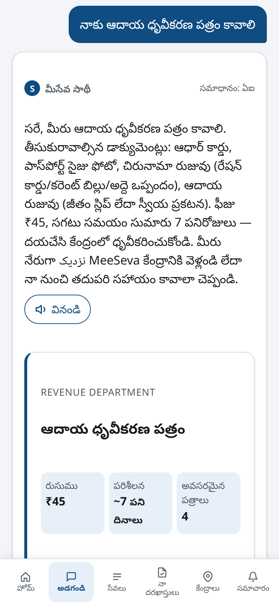 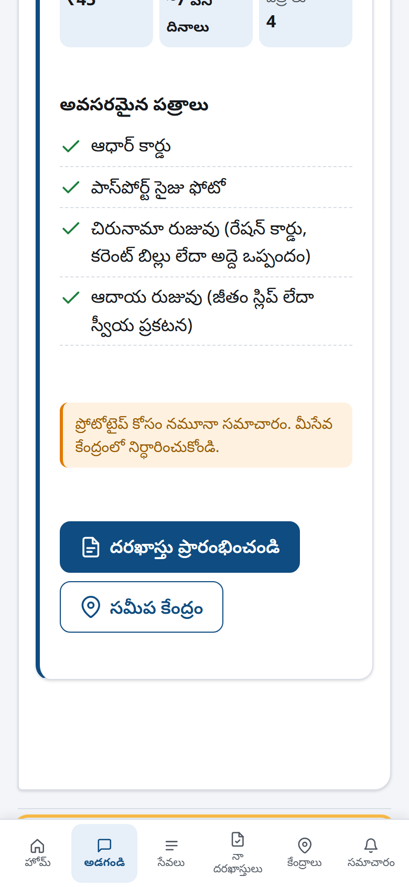

## Scene 3 of 10 · Pension after a death, in English

**Clip:** about 35 s · starts at 0:50 in the video · runbook step 4

**On screen:** Language switched to English; typing “My father passed away and we need to claim his pension”; the answer, the Death Certificate card and the “Answered by: AI” label.

> Citizens describe a situation, not a certificate name. I switch to English and say: my father passed away and we need to claim his pension. The AI understands that a pension claim needs a death certificate first, lists the documents, and points to the family member certificate that comes next. The small label shows that the AI answered. If the AI is ever unavailable, the built-in catalogue engine answers instead, so Saathi is never down.

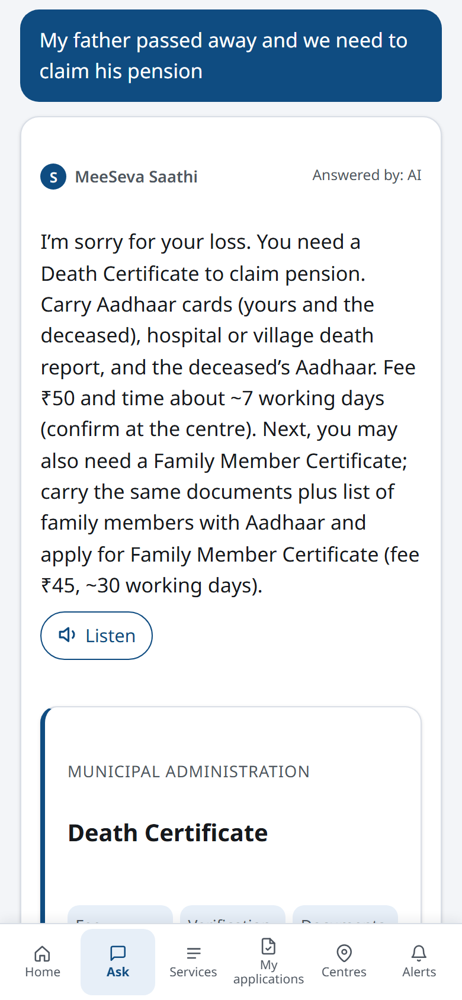

## Scene 4 of 10 · Not a MeeSeva service

**Clip:** about 16 s · starts at 1:26 in the video · runbook step 5

**On screen:** Typing “how do I renew my passport”; the “MeeSeva does not provide…” reply with suggestion chips.

> When something is not a MeeSeva service, like a passport renewal, Saathi says so and suggests the closest services instead of guessing. Every unanswered question is logged for the department as a possible service gap.

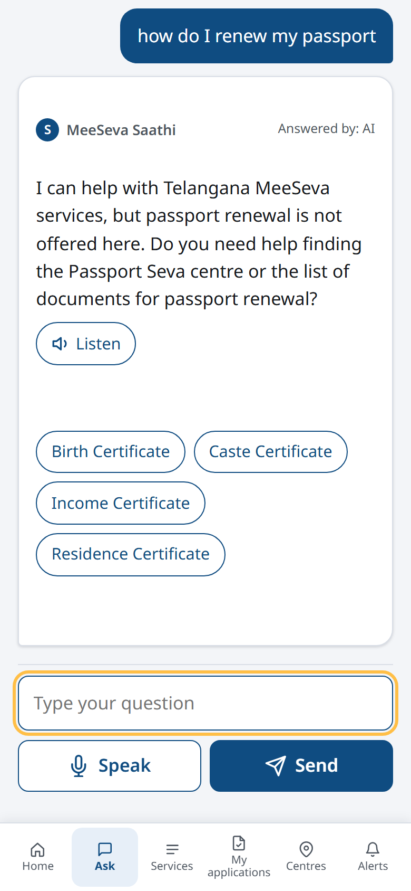

## Scene 5 of 10 · Login with OTP

**Clip:** about 14 s · starts at 1:43 in the video · runbook steps 6–7

**On screen:** Log in: mobile 9876543210, Get OTP, the OTP shown in the orange box, name Ravi Kumar, Verify.

> To start an application, the citizen logs in with a mobile number and a one-time password. In the prototype the OTP is shown on screen, because no SMS gateway is connected yet.

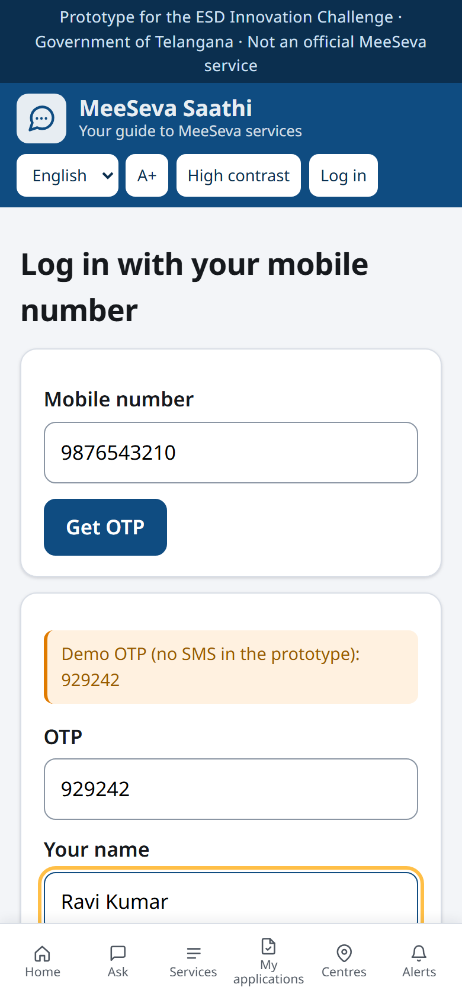

## Scene 6 of 10 · Checklist, submit, timeline

**Clip:** about 27 s · starts at 1:59 in the video · runbook steps 8–11

**On screen:** Residence Certificate → Start application → purpose “School admission” → three documents ticked → Submit → status “Submitted” with the four-step timeline and “What this means / What to do next”.

> Saathi creates a document checklist for the residence certificate. The citizen ticks each document as they collect it, and cannot submit until the list is complete. That removes the single biggest cause of repeat visits. After submission, a four-step timeline shows where the application is, with what this means and what to do next, in the citizen's language.

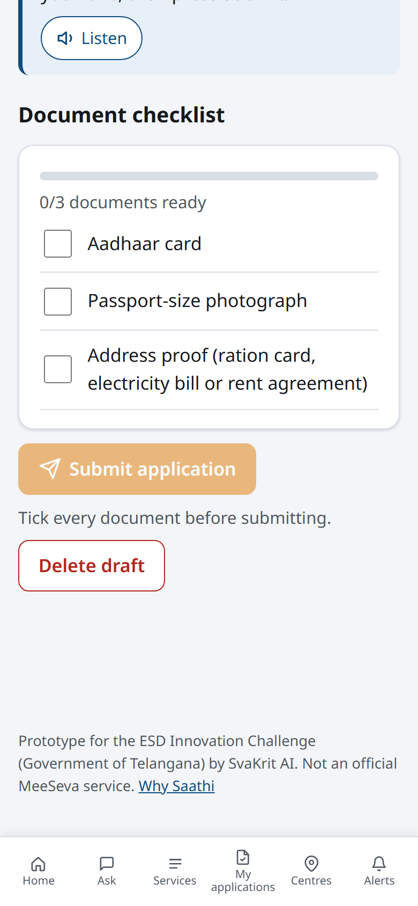 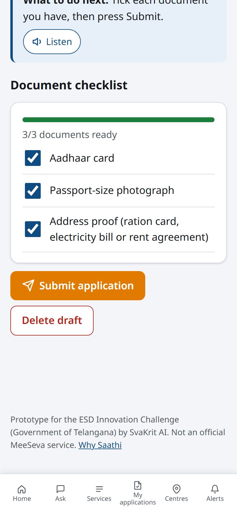 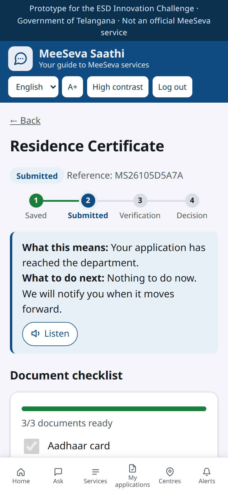

## Scene 7 of 10 · Urdu, right-to-left

**Clip:** about 13 s · starts at 2:27 in the video · runbook step 13

**On screen:** Language → اردو; the interface flips to right-to-left; typing مجھے پیدائش سرٹیفکیٹ چاہیے; the Urdu answer with the Birth Certificate card.

> The same works in Urdu, with the whole interface switching to right-to-left, and in Hindi. The official MeeSeva portal today is available in English and Telugu only.

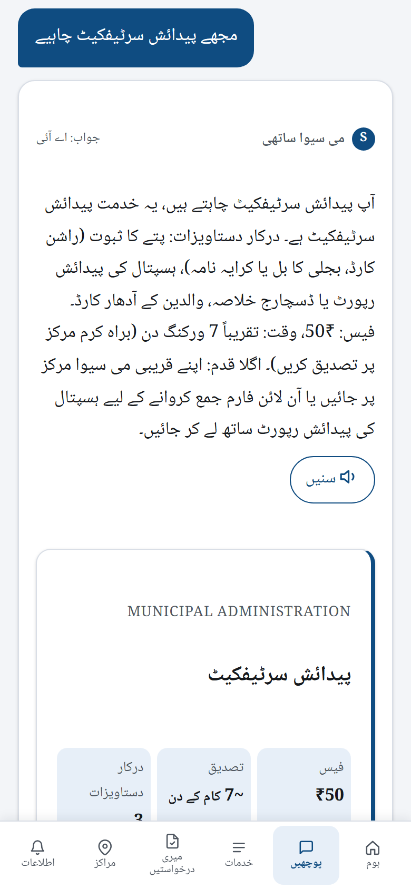

## Scene 8 of 10 · Officials’ dashboard

**Clip:** about 22 s · starts at 2:40 in the video · runbook steps 14–17

**On screen:** Desktop frame. Official login (9000000001); KPI tiles, most requested services, questions by language; scroll to service gaps and tagged feedback; the Ravi Kumar row set to “Needs documents” with a remark; Save & notify.

> For the ESD Wing, the officials' dashboard shows what citizens ask most, in which languages, the questions the catalogue could not answer, which are candidates for new services, and feedback tagged by sentiment and topic. Here an officer updates an application and adds a remark for the citizen.

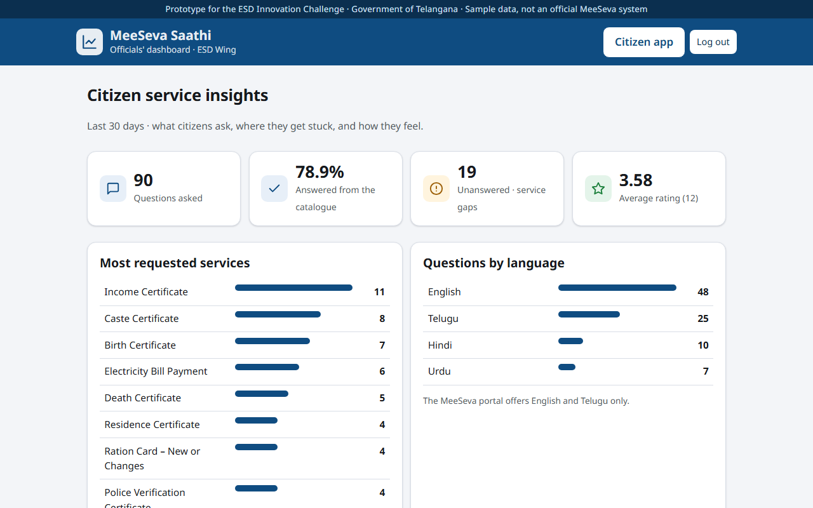 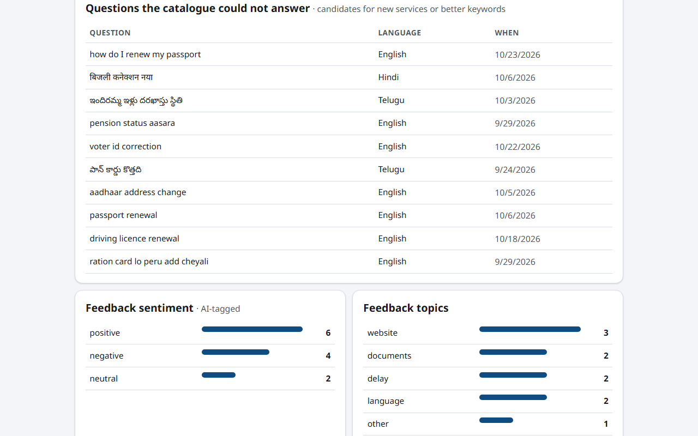 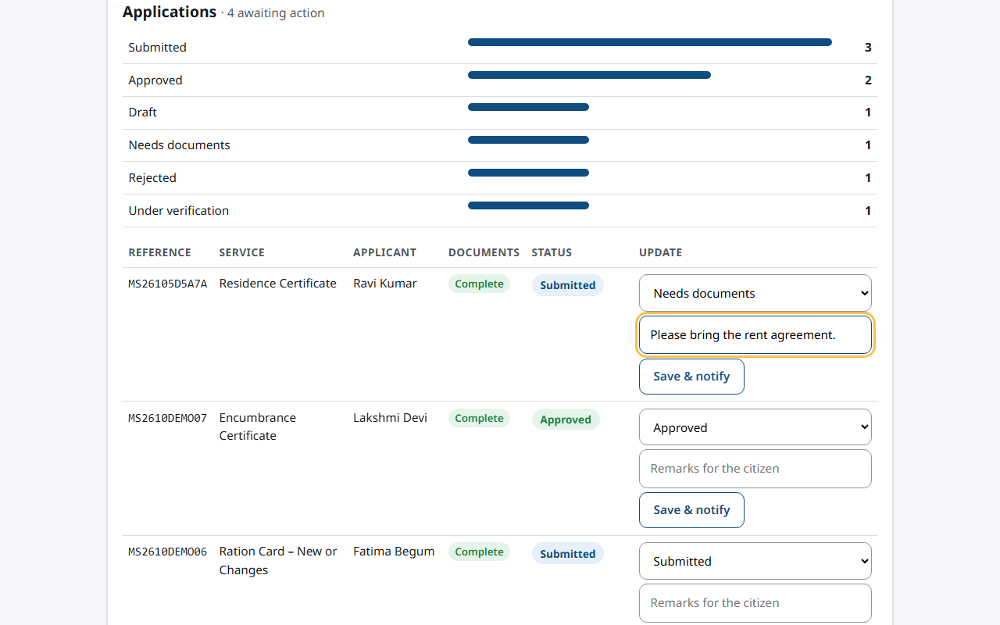

## Scene 9 of 10 · Citizen notification

**Clip:** about 8 s · starts at 3:03 in the video · runbook step 18

**On screen:** Back to the phone. Alerts tab with the badge; the notification card with the status explanation and the officer’s remark.

> The citizen receives that update as a notification, in their own language, with the officer's remark.

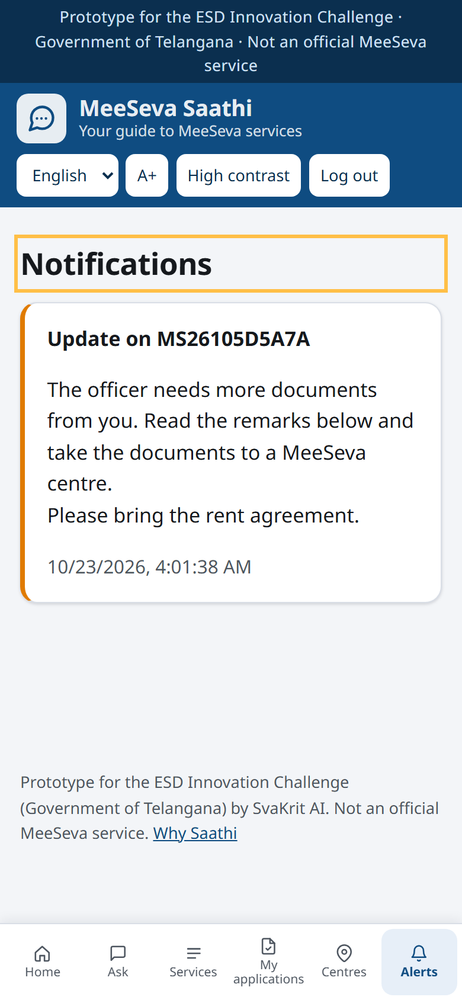

## Scene 10 of 10 · Why Saathi

**Clip:** about 14 s · starts at 3:12 in the video · runbook step 19

**On screen:** The Why Saathi page: the four MeeSeva figures and findings → design decisions; slow scroll; ends on the GitHub link.

> The research behind the design, with the official MeeSeva numbers, is inside the app under Why Saathi. The code, tests and documentation are open on GitHub. Thank you.

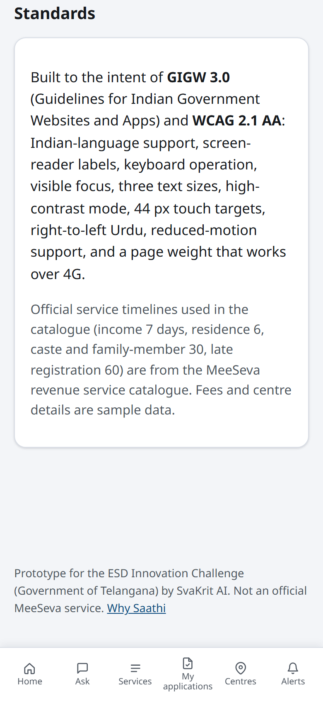

---

Generated by `python -m scripts.demo_script` from `demo_segments.json`, `audio/durations.json` and `timestamps.json`. To change the words, edit `demo_segments.json`, then re-run narrate, record_demo, build_demo_video and this script.
