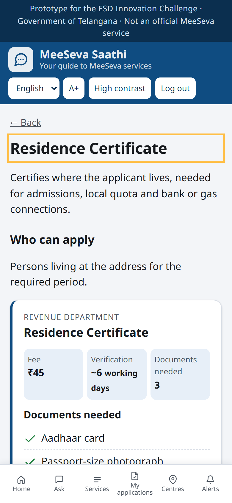
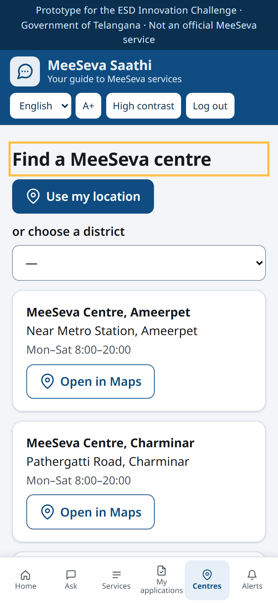

# Live demo runbook

Keep this open on a second screen while recording. Each step gives the exact text to type, what the screen
should show (screenshot from the current build), and one sentence to say. Total: about 4 minutes.

## Before you press record (5 minutes)

```bash
cd meeseva-saathi
.venv\Scripts\activate            # Windows
python -m app.seed --demo         # fresh database with sample citizen activity (dashboard is populated)
uvicorn app.main:app --port 8000
```

1. Open **Chrome in an incognito window** (so the language starts in Telugu and nobody is logged in).
2. Press **F12 → device toolbar (Ctrl+Shift+M)** → choose **iPhone 14 Pro** or set 390 × 844. Zoom the page to 125–150 % so text is readable in the recording. Close the DevTools panel itself (keep the device frame).
3. Open a **second, normal window** for the officials' dashboard at http://127.0.0.1:8000/official, sized 1280 × 800.
4. Phone window: go to http://127.0.0.1:8000. It should look like step 1.
5. Microphone: the **Speak** button uses Chrome's speech recognition. It works online in Chrome; test it once before recording. If it fails, type instead; nobody will notice.

**Reset at any time:** stop the server, run `python -m app.seed --demo`, start it again, open a new incognito window.

Copy-paste lines (keep this block handy):

```
నాకు ఆదాయ ధృవీకరణ పత్రం కావాలి
My father passed away and we need to claim his pension
how do I renew my passport
9876543210
Ravi Kumar
School admission
مجھے پیدائش سرٹیفکیٹ چاہیے
Please bring the rent agreement.
```

---

## Part 1 · Ask Saathi (phone window) — about 1 min 20 s

| # | Do | You should see | Say |
|---|---|---|---|
| 1 | Open the home page. Pause 3 s. | Telugu home: question box, popular services, category tiles, top strip "Prototype".  | "This is MeeSeva Saathi. A citizen opens it on any phone and sees one question box, in Telugu by default." |
| 2 | Click the question box and type (or press **మాట్లాడండి** and say) `నాకు ఆదాయ ధృవీకరణ పత్రం కావాలి`, then **పంపండి**. | Your question appears as a blue bubble; after 2–4 s the Telugu answer appears, "Answered by: AI".  | "I say I need an income certificate. Saathi answers in Telugu: the service, the documents, the fee and the official seven-day timeline." |
| 3 | Scroll down a little. Tap **వినండి** (Listen) for 3 s, then stop. | The service card: Revenue Department, fee ₹45, ~7 working days, four documents with ticks, "Start application" and "Nearest centre".  | "Every answer has a card and a Listen button for people who cannot read easily." |
| 4 | Change the language dropdown to **English**. Type `My father passed away and we need to claim his pension` → **Send**. | English answer: "I am sorry for your loss. You need a Death Certificate…" with the three documents, then the Death Certificate card.  | "Citizens describe a situation, not a certificate name. The AI understands that a pension claim needs a death certificate first." |
| 5 | Type `how do I renew my passport` → **Send**. | "MeeSeva does not provide passport services…" and four suggestion chips.  | "When something is not a MeeSeva service, Saathi says so instead of guessing, and the department sees the question later as a service gap." |

## Part 2 · Prepare and track (phone window) — about 1 min 20 s

| # | Do | You should see | Say |
|---|---|---|---|
| 6 | Tap **Log in** (top right). Type `9876543210` → **Get OTP**. | The OTP appears on screen in an orange box.  | "Login is mobile plus OTP. In the prototype the OTP is shown on screen because no SMS gateway is connected." |
| 7 | Type the 6-digit OTP and `Ravi Kumar` → **Verify and continue**. | "My applications" page, empty for a new user. | — |
| 8 | Tap **Services** in the bottom bar, then **Residence Certificate**. | Service page with description, eligibility, documents, "Start application".  | "Nineteen services across six categories, with the official timelines." |
| 9 | Tap **Start application**. Purpose: `School admission` → **Save checklist**. | The application: Draft, timeline at step 1, the checklist with 0/3 documents, Submit disabled.  | "Saathi creates a document checklist. Submit stays disabled until everything is ticked." |
| 10 | Tick the three documents one by one. | Progress bar fills to 3/3; the orange **Submit application** button becomes active.  | "That removes the single biggest cause of repeat visits: a missing paper." |
| 11 | Tap **Submit application**. Scroll to the top. | Status "Submitted", timeline step 2 highlighted, "What this means / What to do next" box.  | "After submission, the status explains itself: what it means and what to do next, in the citizen's language." |
| 12 | Tap **Centres** in the bottom bar. | Five centres with address, hours and "Open in Maps".  | "And the nearest MeeSeva centre, from the phone's location or by district." |

## Part 3 · Urdu (phone window) — 20 s

| # | Do | You should see | Say |
|---|---|---|---|
| 13 | Language dropdown → **اردو**. Tap **پوچھیں** (Ask). Type `مجھے پیدائش سرٹیفکیٹ چاہیے` → send. | The whole interface flips right-to-left; Urdu answer with the Birth Certificate card.  | "The same in Urdu, right-to-left, and in Hindi. The official portal today is English and Telugu only." |

## Part 4 · Officials' dashboard (desktop window) — 50 s

| # | Do | You should see | Say |
|---|---|---|---|
| 14 | Switch to the desktop window. Mobile is pre-filled with `9000000001` → **Get OTP** → type the OTP → **Verify**. | Dashboard: four KPI tiles (questions asked, answered %, service gaps, average rating), most requested services, questions by language.  | "For the ESD Wing: what citizens ask most, and in which languages." |
| 15 | Scroll to **Questions the catalogue could not answer**. | A table of unanswered questions: driving licence, passport, Aadhaar changes…  | "The questions it could not answer are candidates for new services. Below, feedback is tagged by sentiment and topic." |
| 16 | Scroll to **Applications**. In the first row (Ravi Kumar, Residence Certificate) change the status to **Needs documents**, type `Please bring the rent agreement.` in Remarks. | Row with the dropdown and remark filled, "Save & notify" button.  | "An officer updates the application and adds a remark." |
| 17 | Click **Save & notify**. | The row's status chip changes to "Needs documents". | — |

## Part 5 · Close (phone window) — 20 s

| # | Do | You should see | Say |
|---|---|---|---|
| 18 | Back to the phone. Tap **Alerts** (bell, with a badge "1"). | The notification card: "Update on MS…", the status explanation and the officer's remark.  | "The citizen gets that update as a notification, in their language, with the remark." |
| 19 | Tap **Why Saathi** in the footer. Scroll slowly for 5 s. | The research page: four MeeSeva statistics, findings → design decisions.  | "The research behind every design decision is inside the app. Code, tests and docs are open on GitHub. Thank you." |

---

## If something goes wrong

| Problem | What to do |
|---|---|
| The AI answer takes more than 5 s | Keep talking; the answer arrives. If the AI is unavailable, the built-in catalogue engine answers instead (label says "catalogue"). Both are fine to show. |
| The answer wording differs from the screenshot | Normal: the AI phrases each answer slightly differently. The service card is always the same. |
| Wrong language after login | Use the language dropdown; it changes everything instantly. |
| You logged in with the wrong number | **Log out** (top right), log in again with any other 10-digit number. |
| Dashboard shows no applications from "Ravi Kumar" | You skipped step 11. Submit the application on the phone first, then refresh the dashboard. |
| Anything else | Stop the server, `python -m app.seed --demo`, start again, new incognito window. 30 seconds. |

Screenshots in this folder were captured from the build on 23 Oct 2026 with the same steps.
